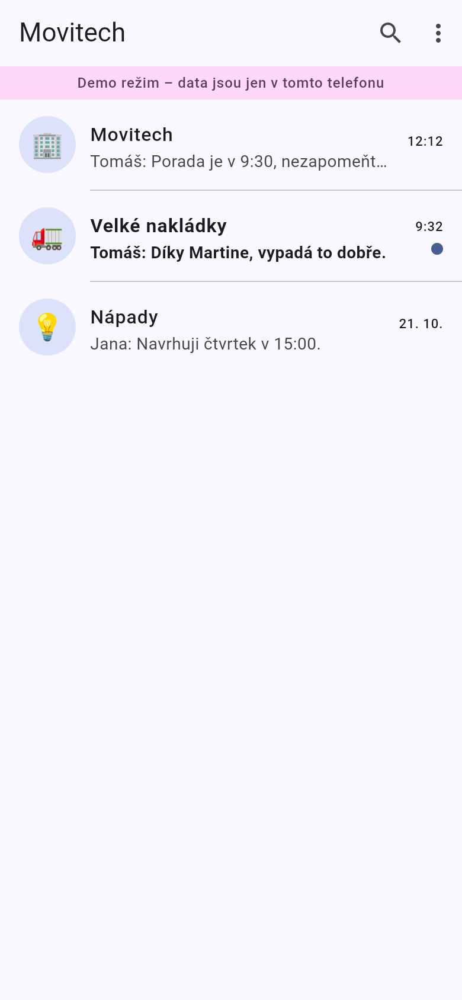
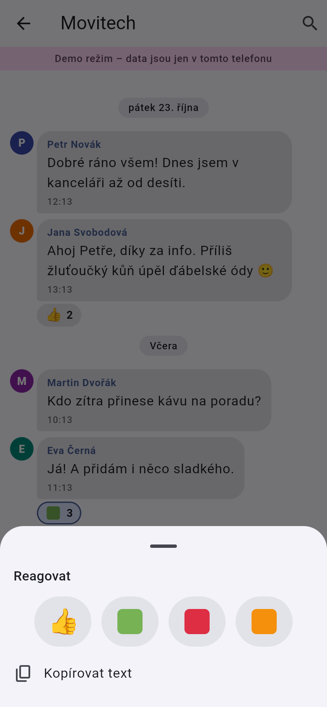
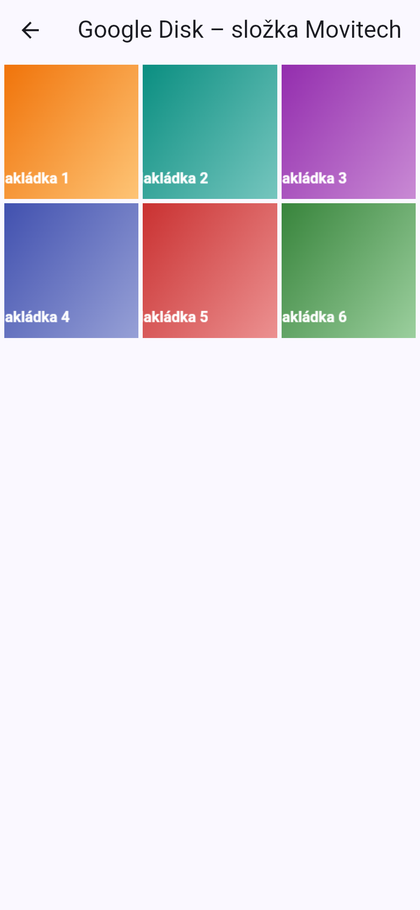
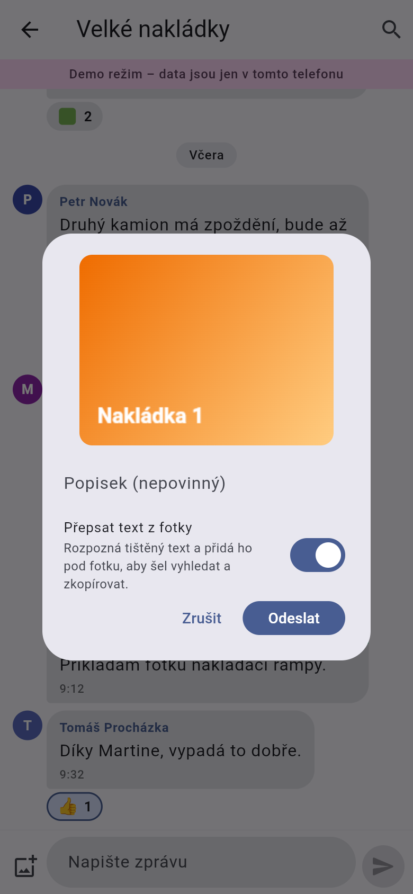
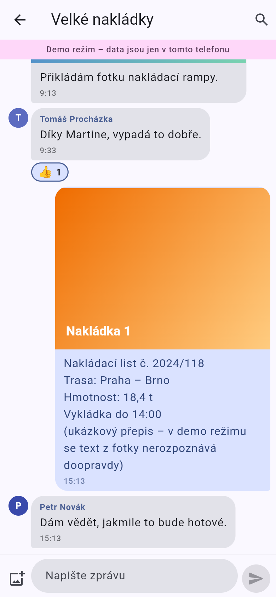
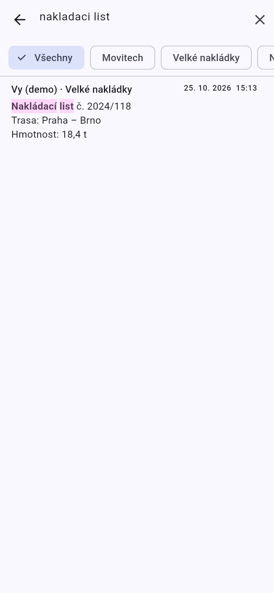

# Movitech

Mobilní chat pro malý tým (max. 6 lidí, 3 místnosti: Movitech, Velké nakládky, Nápady): text, fotky ukládané na
hlavní Google Disk s přepisem textu z fotek, čtyři reakce (👍 🟩 🟥 🟧) a hledání ve zprávách.
Flutter (iOS + Android) + Firebase.

**Nic se nikam nepublikuje** – aplikace se instaluje do vašeho telefonu přímo z počítače.

- 👉 **Jak to vyzkoušet na telefonu: [docs/SPUSTENI.md](docs/SPUSTENI.md)**
  (demo režim bez jakýchkoli účtů, nebo ostrý režim s Firebase a Google)
- Návrh, architektura, schéma databáze: [docs/SPECIFICATION.md](docs/SPECIFICATION.md)

## Náhled

Snímky demo režimu (webová verze v rozměru telefonu, ne skutečný telefon):

<p>
 
 
 
</p>

## Rychlý start (demo, bez účtů)

```bash
flutter pub get
flutter run --release --dart-define=DEMO=true      # s připojeným telefonem
```

## Struktura

```
lib/            aplikace (features/auth, rooms, chat, drive, search, notifications; demo/)
gateway/        skript pro Google Apps Script: fotky na hlavním Google Disku + přepis textu (OCR)
firestore.rules pravidla databáze (jen e-maily z allowlistu)
functions/      volitelná Cloud Function pro push notifikace
tools/          seed skript (místnosti + allowlist), nastavení iOS přihlášení
backend-tests/  testy pravidel a brány pro fotky (Firestore emulátor)
test/           testy aplikace (flutter test)
```
